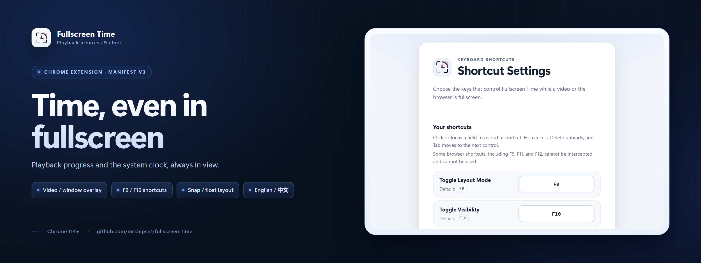
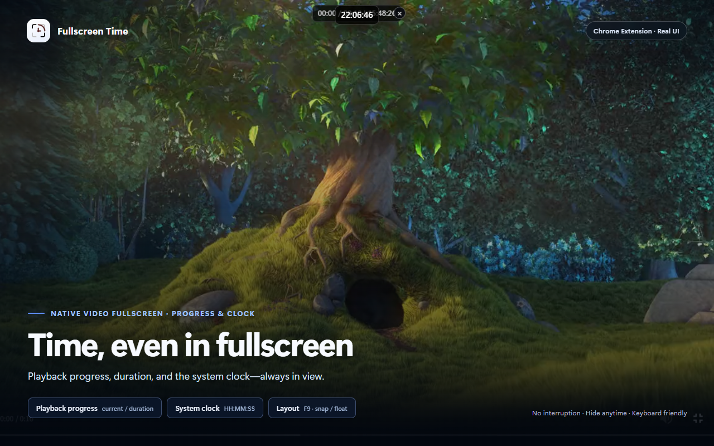
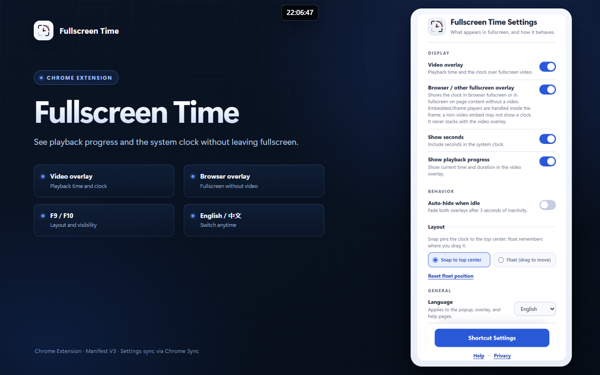
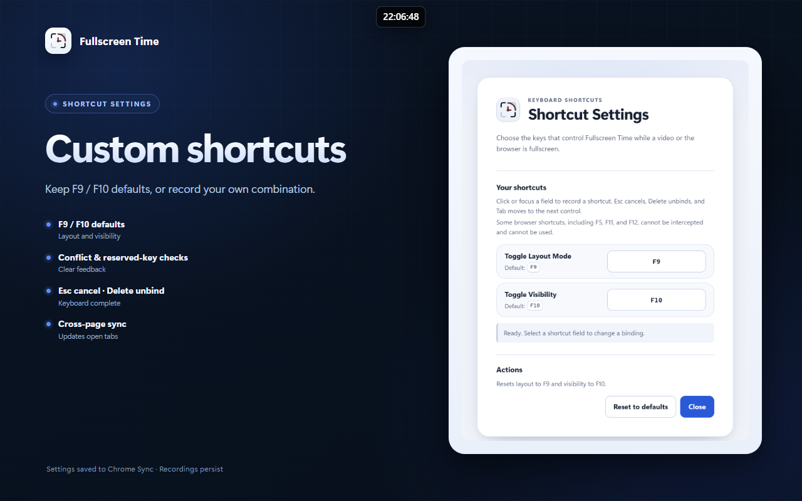

<p align="center">
  
</p>

<p align="center">
  <a href="README.md">中文</a> | English
</p>

# Fullscreen Time

A Chrome / Edge extension (Manifest V3) that overlays playback progress and the system clock while a video, the browser, or a non-video element is fullscreen. No need to leave fullscreen and no interruption to playback.

- Works with native `<video>` fullscreen, player-container fullscreen, F11 browser fullscreen, and regular element fullscreen
- Snap-to-top or draggable float layout
- Default `F9` for layout and `F10` for visibility, with a custom shortcut recorder
- English / Chinese UI
- No developer server, ads, analytics, or runtime network dependency

## Features

- **Video overlay**: shows `current time / duration | system clock`, updated every second.
- **Browser / non-video overlay**: shows `HH:MM:SS` in F11 or non-video element fullscreen.
- **Display controls**: independently toggle seconds, playback progress, and idle auto-hide.
- **Layout and position**: snap to top center or drag to float; video/window positions are remembered separately and can be reset.
- **Shortcuts**: `F9` toggles layout, `F10` toggles visibility. The settings page records custom combinations, validates conflicts and reserved browser keys, and supports Esc to cancel, Delete to unbind, and reset to defaults.
- **Close and restore**: the overlay has a close button; it restores when fullscreen exits and can be toggled with a shortcut.
- **Compatibility**: iframe/frame/embed/object players, multiple videos, SPA-loaded videos, and live streams (`--:--` when duration is unavailable).
- **Accessibility**: dark mode, reduced motion, visible focus, and keyboard operation.
- **Privacy**: only the current video's playback time, duration, and system time are read locally. Settings are stored in `chrome.storage.sync`.

## Screenshots

| Video fullscreen | Popup settings | Shortcut settings |
| --- | --- | --- |
|  |  |  |

## Install

Requirements: Chrome or Edge (Chromium) **114+**; Node.js 22+ and pnpm are only needed for building.

### Load from source

```bash
pnpm install
pnpm run build-prod
```

1. Open `chrome://extensions`
2. Enable **Developer mode**
3. Click **Load unpacked**
4. Select the `extension/` directory in this repository
5. Rebuild after editing `src/`, reload the extension, and refresh any open tabs

To support local video files, explicitly enable **Allow access to file URLs** in the extension details.

## Shortcuts

| Action | Default | Notes |
| --- | --- | --- |
| Toggle layout | `F9` | Snap to top center ↔ draggable float |
| Toggle visibility | `F10` | Temporary; restores when fullscreen exits |

Defaults can be re-recorded on the **Shortcut Settings** page. Shortcuts work while fullscreen; inputs, editable fields, IME composition, and key repeat are ignored. Shortcut toggles are temporary overrides and are not written to storage; bindings recorded in the settings page are persisted.

## Development

```bash
pnpm install
pnpm run build-dev    # unminified, inline source map
pnpm run build-prod   # minified production build, no source map
pnpm run watch        # development + watch
pnpm run clean        # remove build artifacts
```

- `src/` contains the content-script source; the build artifact is `extension/content.js` and is committed.
- Use `pnpm run build-prod` for release/testing builds.
- VSCode can start the **Debug Chrome Extension** configuration with F5; source maps exist only in `build-dev`.
- Manual acceptance procedure (Chinese): [docs/testing-sop.md](docs/testing-sop.md).

## Project structure

```text
src/                  # content-script source
extension/            # unpacked Manifest V3 extension
extension/popup/      # popup settings
extension/settings/   # shortcut recorder
extension/shared/     # page i18n and design tokens
extension/_locales/   # en / zh_CN
docs/                 # testing SOP, privacy policy, review notes
site/                 # GitHub Pages privacy policy and landing page
store/                # Chrome Web Store assets and listing copy
```

## Privacy

The extension does not collect, sell, or transmit data to the developer or third parties. It contains no developer server, ads, tracking scripts, or remote code. Settings are stored in `chrome.storage.sync` and may sync across devices signed into the same Chrome account.

- Public privacy policy: https://mrchipset.github.io/fullscreen-time/privacy-policy.html
- Repository policy source: `docs/privacy-policy.md`
- In-extension privacy section: `extension/doc.html#privacy`

## Links

- GitHub: https://github.com/mrchipset/fullscreen-time
- Issues: https://github.com/mrchipset/fullscreen-time/issues
- Testing SOP (Chinese): [docs/testing-sop.md](docs/testing-sop.md)
- Chrome Web Store preparation: [store/README.md](store/README.md)

Current version: `V1.0.0`
