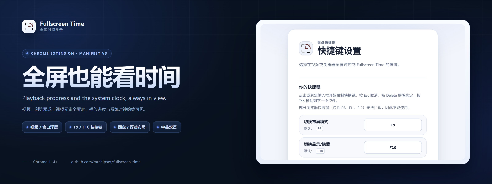
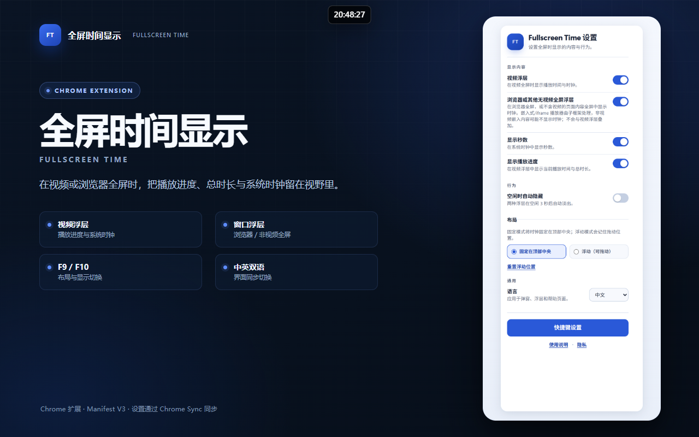
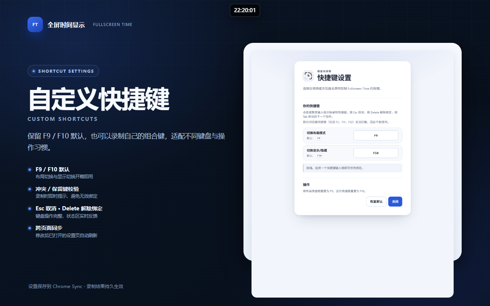

<p align="center">
  
</p>

<p align="center">
  <a href="README.en.md">English</a> | 中文
</p>

# Fullscreen Time — 全屏时间显示

一款 Chrome / Edge（Manifest V3）扩展：在视频、浏览器或非视频元素全屏时，把播放进度和系统时钟叠加在屏幕顶部。无需退出全屏，也不会打断视频播放。

- 支持原生 `<video>` 全屏、播放器容器全屏、F11 浏览器全屏和普通元素全屏
- 固定顶部居中或浮动可拖动两种布局
- 默认 `F9` 切换布局、`F10` 切换显示/隐藏，支持自定义录制
- 中文 / English 双语界面
- 无开发者服务器、无广告、无统计分析，运行时不需要网络

## 功能特性

- **视频浮层**：显示 `当前播放时间 / 总时长 | 系统时钟`，每秒更新。
- **浏览器/无视频全屏浮层**：在 F11 或非视频元素全屏时仅显示 `HH:MM:SS`。
- **显示控制**：独立开关秒数、播放进度和空闲自动隐藏。
- **布局与位置**：固定顶部居中或浮动拖动；视频/窗口位置分别记忆，可一键重置。
- **快捷键**：`F9` 布局、`F10` 显示/隐藏；设置页可录制组合键，校验冲突与浏览器保留键，支持 Esc 取消、Delete 解绑、恢复默认。
- **关闭与恢复**：浮层提供关闭按钮；退出全屏后自动恢复，也可用快捷键临时隐藏/显示。
- **兼容性**：支持 iframe/embed/object 播放器、多视频页面、SPA 动态加载和直播流（不可用时长显示为 `--:--`）。
- **可访问性**：深色模式、减少动态效果、可见焦点环和键盘操作。
- **隐私**：仅本地读取当前视频的播放时间、总时长和系统时间；设置保存在 `chrome.storage.sync`。

## 界面

| 视频全屏 | 弹窗设置 | 快捷键设置 |
| --- | --- | --- |
|  |  |  |

## 安装

环境要求：Chrome 或 Edge（Chromium）**114+**，Node.js 22+、pnpm（仅构建需要）。

### 从源码加载

```bash
pnpm install
pnpm run build-prod
```

1. 打开 `chrome://extensions`
2. 开启右上角「开发者模式」
3. 点击「加载已解压的扩展程序」
4. 选择仓库中的 `extension/` 目录
5. 修改 `src/` 后重新构建，并在扩展管理页重新加载；已打开的页面需要刷新

如果希望支持本地视频文件，请在扩展详情中额外开启「允许访问文件网址」。

## 快捷键

| 功能 | 默认键 | 说明 |
| --- | --- | --- |
| 切换布局模式 | `F9` | 固定顶部居中 ↔ 浮动可拖动 |
| 切换显示/隐藏 | `F10` | 临时切换，退出全屏后恢复 |

默认值可在「快捷键设置」页重新录制。快捷键在全屏状态下生效；输入框、可编辑区域、IME 组合输入和按键重复不会触发。快捷键切换属于临时覆盖，不写入存储；设置页录制的绑定会持久化。

## 开发与构建

```bash
pnpm install
pnpm run build-dev    # 未压缩，含 inline source map
pnpm run build-prod   # 生产构建，压缩且无 source map
pnpm run watch        # 开发 + 监听
pnpm run clean        # 清理构建产物
```

- `src/` 是内容脚本源码，构建产物为 `extension/content.js`，该文件提交在仓库中。
- 生产构建会压缩代码；发布/验收前请使用 `pnpm run build-prod`。
- VSCode 可按 F5 启动「Debug Chrome Extension」配置；source map 只在 `build-dev` 中存在。
- 手动验收流程见 [docs/testing-sop.md](docs/testing-sop.md)。

## 项目结构

```text
src/
├── index.js          # 内容脚本入口、全屏调度、快捷键
├── widgets.js        # 视频/窗口浮层、拖拽、自动隐藏
├── utils.js          # 时间格式化、浏览器全屏检测
├── i18n.js           # 内容脚本 i18n
└── shortcutKeys.js   # 快捷键规范化

extension/
├── manifest.json     # Manifest V3
├── content.js        # 构建产物（生产版本）
├── background.js     # 空 Service Worker
├── popup/            # 弹窗设置
├── settings/         # 快捷键录制页
├── shared/           # 页面 i18n 与设计令牌
├── _locales/         # en / zh_CN
├── doc.html          # 使用说明、关于、隐私
└── icons/            # 扩展图标

docs/                 # 测试 SOP、隐私政策、评审记录
site/                 # GitHub Pages 隐私政策与落地页
store/                # Chrome Web Store 素材与文案
```

## 隐私

本软件不收集、不出售、不向开发者或第三方发送数据；不包含开发者服务器、广告、跟踪脚本或远程代码。设置通过 `chrome.storage.sync` 保存，可能随登录同一 Chrome 账户的设备同步。

- 公开隐私政策：https://mrchipset.github.io/fullscreen-time/privacy-policy.html
- 源码内隐私说明：`docs/privacy-policy.md`、`extension/doc.html#privacy`

## 相关链接

- GitHub 仓库：https://github.com/mrchipset/fullscreen-time
- 问题反馈：https://github.com/mrchipset/fullscreen-time/issues
- 测试 SOP：[docs/testing-sop.md](docs/testing-sop.md)
- Chrome Web Store 发布材料：[store/README.md](store/README.md)

当前版本：`V1.0.0`
